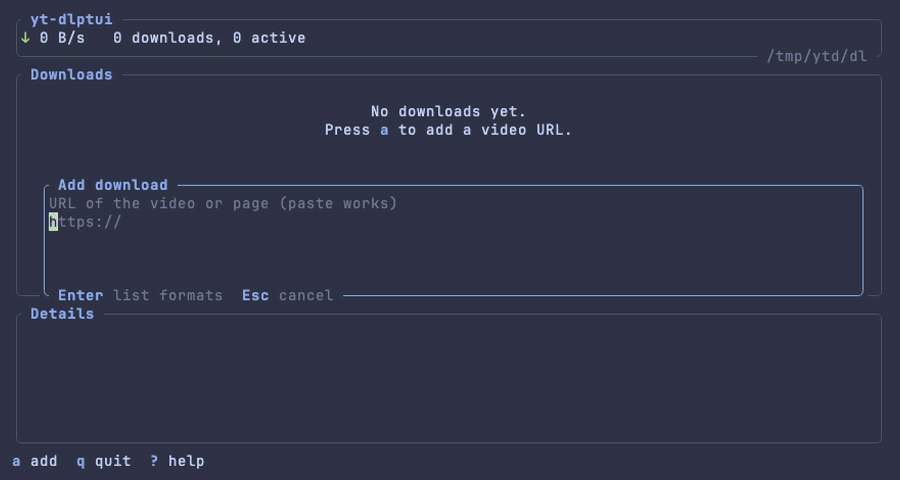

# yt-dlptui

A terminal UI for [yt-dlp](https://github.com/yt-dlp/yt-dlp), built on
[ratatui](https://ratatui.rs) in the style of torrentui.



Press `a`, paste a URL, and yt-dlp is asked which formats the video offers.
They are listed in a modal (resolution, codecs, size, whether the stream has
sound); pick one and it downloads.

## Install

Requires Rust 1.89 or newer and `yt-dlp` on your `PATH` (ffmpeg too, for
formats that merge video and audio).

```
cargo install --path .
```

## Usage

```
yt-dlptui [OPTIONS] [URL]

  -d, --dir <DIR>       download here instead of the configured directory
  -c, --config <FILE>   use this config file
      --theme <NAME>    use this theme for this run
      --list-themes     print available themes and exit
```

With a `URL` the format list opens straight away.

| Key | Action |
| --- | --- |
| `a` | Add: enter a URL, `Enter` lists its formats, `Enter` again downloads the highlighted one |
| `p`, `Space` | Pause / resume; also retries a failed download |
| `d`, `Del` | Remove the entry (asks first); unfinished parts are deleted, a finished video stays |
| `D` | Remove the entry **and delete the video** (asks first) |
| `j` `k` `g` `G`, arrows | Move |
| `T` | Pick a theme: `↑↓` previews live, `b` toggles the transparent background, `Enter` saves it to the config |
| `?` | Help |
| `q`, `Ctrl-C` | Quit; asks first (`y` / `Enter`) while downloads are running, which then pause |

In the format list `Esc` goes back to the URL; `Esc` while it is looking up
formats cancels the lookup. Pasting a URL on the list opens the Add dialog.

The first two rows of the format list are shortcuts: `best` (best video and
audio, merged) and `best audio`. A video-only format is downloaded together
with the best audio stream, so its size column includes it. Playlists are not
expanded: a playlist URL downloads the single video it points at.

Downloads run as child processes of the window. Quitting pauses them; the list
is saved, and `p` resumes from yt-dlp's partial files next time. Unlike
torrentui there is no background daemon.

## Config

`~/.config/yt-dlptui/config.yml` is created on first start with every key
commented out. Unknown keys are errors.

| Key | Default | |
| --- | --- | --- |
| `download_dir` | your Downloads folder | `~` is expanded |
| `theme` | `default` | see [Themes](#themes); saved by `T` |
| `transparent_background` | `true` | let the terminal's background show |
| `yt_dlp` | `yt-dlp` | program to run |
| `extra_args` | `[]` | added to every yt-dlp run, e.g. `["--cookies-from-browser", "firefox"]` |
| `themes` | none | your own themes, see below |

## Themes

Sixteen are built in, the same as torrentui: `default` (plain ANSI colours that
follow your terminal), tokyo-night, the four Catppuccin flavours, dracula,
one-dark, gruvbox-dark, nord, solarized-dark, rose-pine, monokai, github-dark,
everforest and kanagawa. The RGB ones need a true-colour terminal.

On start each built-in is written to `~/.config/yt-dlptui/themes/<name>.yml`
with every colour spelled out; edit it, or copy it to make a new theme named
after the new file. Themes can also be defined in `config.yml`:

```yaml
themes:
  my-theme:
    base: dracula        # optional; unset colours come from here
    accent: "#ff79c6"    # #rrggbb, an ANSI name like red, or 0-255
```

Colour keys: `bg fg muted accent border selection_bg success info warning
error special`. Unknown keys, bad colours and unknown bases are errors naming
the theme and file. Pressing `T` and saving edits only the `theme:` line (and
`transparent_background` if you toggled it), keeping your comments.

The download list lives in `~/Library/Application Support/yt-dlptui/downloads.json`
(`~/.local/share/yt-dlptui/` on Linux). Partial files are kept in
`<download_dir>/.yt-dlptui/<id>/` until the download finishes.
